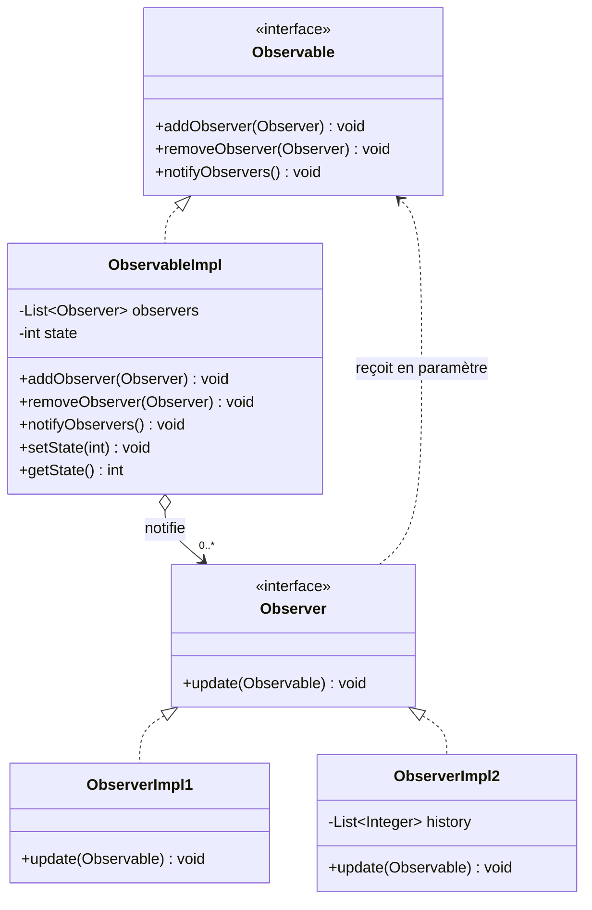
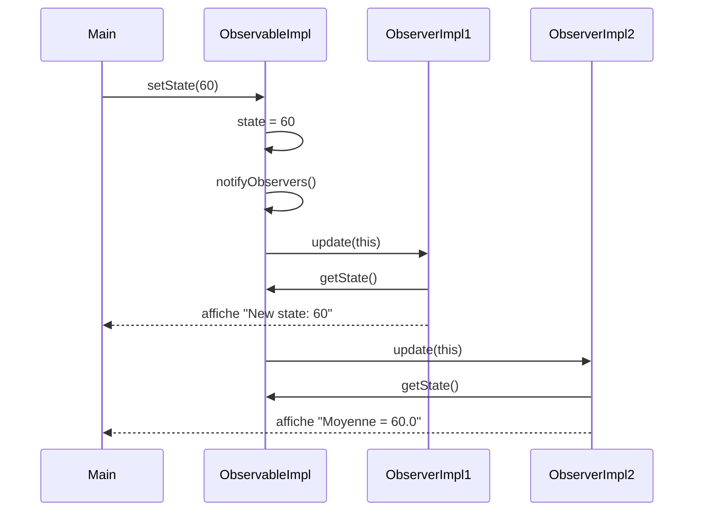
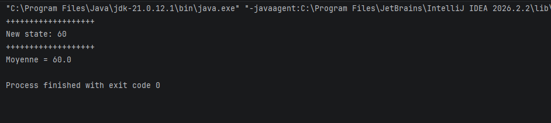
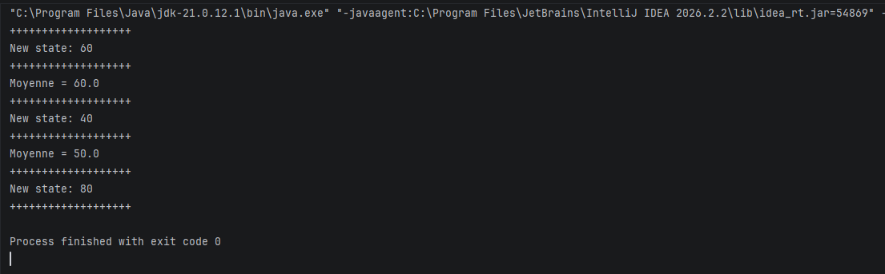

# Observer-DesignPattern


---

## Table des matières

2. [Le pattern Observer](#le-pattern-observer)
3. [Structure du projet](#structure-du-projet)
4. [Architecture et diagrammes](#architecture-et-diagrammes)
5. [Description des classes](#description-des-classes)
6. [Scénario de démonstration](#scénario-de-démonstration)
7. [Prérequis](#prérequis)
8. [Compilation et exécution](#compilation-et-exécution)
9. [Résultat attendu](#résultat-attendu)
10. [Ajouter un nouvel observateur](#ajouter-un-nouvel-observateur)
11. [Limites et pistes d'amélioration](#limites-et-pistes-damélioration)
12. [Historique du projet](#historique-du-projet)
13. [Auteur](#auteur)

---

## Le pattern Observer

L'**Observer** est un pattern comportemental du « Gang of Four » qui définit une dépendance **un-à-plusieurs** entre objets : quand un objet (le *sujet*) change d'état, tous ses dépendants (les *observateurs*) sont notifiés et mis à jour automatiquement.

**Avantages :**

- **couplage faible** : le sujet ne connaît que l'interface `Observer`, pas les classes concrètes ;
- ajout ou retrait d'observateurs **à l'exécution** ;
- respect du principe **Open/Closed** : on ajoute des réactions sans modifier le sujet ;
- diffusion automatique des changements, sans interrogation répétée (polling).

**Cas d'usage typiques :** interfaces graphiques (événements), systèmes de notifications, mises à jour de tableaux de bord, architectures événementielles.

---

## Structure du projet

```
Observer-DesignPattern/
├── pom.xml
├── .gitignore
└── src/
    └── main/
        └── java/
            └── com/
                └── zouhari/
                    ├── Main.java                  # Point d'entrée / démonstration
                    └── obs/
                        ├── Observable.java        # Interface du sujet
                        ├── ObservableImpl.java    # Sujet concret (détient l'état)
                        ├── Observer.java          # Interface de l'observateur
                        ├── ObserverImpl1.java     # Observateur : affiche l'état
                        └── ObserverImpl2.java     # Observateur : calcule la moyenne
```

---

## Architecture et diagrammes

### Diagramme de classes



### Diagramme de séquence d'un changement d'état



Il s'agit ici du modèle **pull** : l'observable passe une référence à lui-même et chaque observateur vient lire l'état dont il a besoin via `getState()`.

---

## Description des classes

### `Observable` (interface)

Contrat du sujet observé :

```java
public interface Observable {
    void addObserver(Observer o);
    void removeObserver(Observer o);
    void notifyObservers();
}
```

### `Observer` (interface)

Contrat de l'observateur, appelé à chaque notification :

```java
public interface Observer {
    void update(Observable observable);
}
```

### `ObservableImpl`

Sujet concret. Il conserve une `List<Observer>` et un entier `state`.

| Méthode | Rôle |
|---|---|
| `addObserver(Observer)` | Ajoute un observateur à la liste |
| `removeObserver(Observer)` | Retire un observateur de la liste |
| `notifyObservers()` | Appelle `update(this)` sur chaque observateur |
| `setState(int)` | Modifie l'état **puis déclenche automatiquement** `notifyObservers()` |
| `getState()` | Retourne l'état courant |

### `ObserverImpl1`



### `ObserverImpl2`

Conserve un historique (`List<Integer>`) de tous les états reçus et affiche à chaque notification la **moyenne** de cet historique (`Moyenne = ...`).

> Les deux observateurs utilisent le *pattern matching* d'`instanceof` de Java (`observable instanceof ObservableImpl obs`) pour accéder à `getState()`, qui n'est pas déclaré dans l'interface `Observable`.

### `Main`

Classe de démonstration qui orchestre le scénario ci-dessous.

---

## Scénario de démonstration

```java
ObservableImpl observable = new ObservableImpl();
Observer o1 = new ObserverImpl1();
Observer o2 = new ObserverImpl2();

observable.addObserver(o1);
observable.addObserver(o2);

observable.setState(60);          // o1 et o2 notifiés
observable.setState(40);          // o1 et o2 notifiés
observable.removeObserver(o2);    // o2 se désabonne
observable.setState(80);          // seul o1 est notifié
```

---



---

## Résultat attendu

```text
+++++++++++++++++++
New state: 60
+++++++++++++++++++
Moyenne = 60.0
+++++++++++++++++++
New state: 40
+++++++++++++++++++
Moyenne = 50.0
+++++++++++++++++++
New state: 80
+++++++++++++++++++
```

| Étape | Observateurs notifiés | Affichage |
|---|---|---|
| `setState(60)` | `o1`, `o2` | `New state: 60` puis `Moyenne = 60.0` |
| `setState(40)` | `o1`, `o2` | `New state: 40` puis `Moyenne = 50.0` |
| `removeObserver(o2)` | — | `o2` ne reçoit plus rien |
| `setState(80)` | `o1` uniquement | `New state: 80` |

---

## Ajouter un nouvel observateur

Aucune modification de `ObservableImpl` n'est nécessaire. Il suffit de créer une classe qui implémente `Observer` :

```java
package com.zouhari.obs;

public class ObserverImpl3 implements Observer {
    @Override
    public void update(Observable observable) {
        if (observable instanceof ObservableImpl obs && obs.getState() > 70) {
            System.out.println("Alerte : seuil dépassé (" + obs.getState() + ")");
        }
    }
}
```

Puis l'enregistrer dans `Main` :

```java
observable.addObserver(new ObserverImpl3());
```

---

## Auteur

**ZOUHARI Dyae Errahmane** --- [GitHub](https://github.com/zouharidyaeerrahmane)